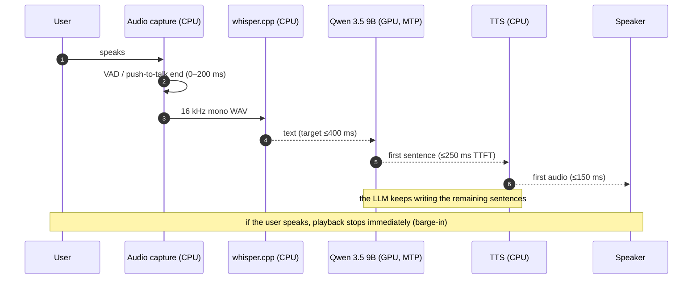

# Architecture

This document defines Altai's design, data flow and
**latency budget**.

## 1. Core principle

**Only the language model runs on the GPU; STT and TTS run on the CPU.**

Reason: on 8 GB VRAM, Qwen 3.5 9B (imatrix Q5_K_M, with MTP) sits at the card's limit. Putting STT
(whisper.cpp) and TTS on the GPU would force model swapping — which kills the `<1 s` target.
So the work is divided and the language model stays **resident**.

## 2. Data flow

```
                 ┌─────────────────────────── CPU ───────────────────────────┐
                 │                                                           │
 Microphone ──► VAD/recording ──► whisper.cpp ──► text                       │
                 │                                 │                         │
                 │                                 ▼                         │
                 │                 ┌──── GPU: Qwen 3.5 9B (MTP) ────┐        │
                 │                 │  response tokens (stream)      │        │
                 │                 └────────────┬───────────────────┘        │
                 │                              ▼                            │
 Speaker ◄── playback ◄── TTS (Chatterbox/Piper) ◄── first sentence ◄──┘     │
                 └───────────────────────────────────────────────────────────┘
```

**Pipeline (parallel):** the LLM produces the first sentence → it goes straight to TTS → while the
user hears it, the LLM writes the rest. Total latency = the slowest single chain.

### 2.1 Timeline of a turn



### 2.2 Component responsibilities

| Component | Responsibility | Input | Output | Error case |
|---|---|---|---|---|
| Audio capture | Record, VAD/end decision | Microphone | 16 kHz mono WAV | No device → notify, cancel turn |
| ASR (whisper.cpp) | Turn speech into text | WAV | Text | Empty/meaningless → "I didn't understand" |
| LLM (9B + MTP) | Produce response (stream) | Text + history | Token stream | Server missing → restart |
| Pipeline | Parallelise, split into sentences | Token stream | Sentences | Timeout → partial response |
| TTS | Turn sentence into audio | Sentence | Audio | Engine error → fall back to text |
| Playback | Play audio, stop on barge-in | Audio | Speaker | No device → fall back to text |
| UI (WinForms) | Status, history, mode | Events | UI | — |

## 3. Latency budget (target < 1000 ms)

| Stage | Target | Method |
|---|---|---|
| Endpoint | 0–200 ms | Push-to-talk = 0; VAD + ~200 ms threshold |
| STT (whisper.cpp) | ≤ 400 ms | `large-v3-turbo`; `medium`/`small` if needed |
| LLM first token | ≤ 250 ms | Resident model + **KV prefix cache** |
| TTS first audio | ≤ 150 ms | Chatterbox/Piper, on the first sentence (Trendyol-TTS/`voxcpm` not suitable for live) |
| Playback buffer | ~50 ms | Small buffer |

> t₀ = last word ended · t₁ = first audio emitted · Target `t₁ − t₀ < 1000 ms`

## 4. STT: whisper.cpp

Speech → text is done with **whisper.cpp** (Qwen3-ASR is not used).

> **History:** the first plan chose whisper.cpp (`large-v3-turbo`) for STT; for a while it was
> switched to **Qwen3-ASR-1.7B**; on **2026-10-16** it went back to whisper.cpp. For the rationale and
> alternatives see [`decisions.md`](decisions.md) → decision #11.

| Field | Value |
|---|---|
| Engine | **whisper.cpp** (MIT, C/C++) |
| Model | **large-v3-turbo** (default) |
| License | MIT (engine and weights) |
| Language | Multilingual; **Turkish (tr) supported** |
| Capability | Offline batch inference; streaming/chunked use possible |
| Size | turbo ~1.6 GB (Q5) · medium ~1.5 GB · small ~0.5 GB |
| Where | **CPU** — `whisper.cpp` / `whisper-cli` |
| Fallback | `medium`, `small` (faster, slightly weaker) |

- Mature, widely used; scales well with CPU thread settings.
- **Speed warning:** on CPU `large-v3-turbo` takes ~0.2–0.4 s for a typical sentence. For a long
  sentence `<1 s` is borderline; VAD segmentation + chunk parallelism compensates. Fall back to
  `medium`/`small` if needed. Measured in Phase 2.
- Speech is segmented with Silero VAD (silence filter).

## 5. LLM: Huihui-Qwen3.5-9B-abliterated i1-Q5_K_M + MTP (always on)

| Field | Value |
|---|---|
| Model | **Huihui-Qwen3.5-9B-abliterated i1-Q5_K_M** (GGUF, imatrix) |
| File | `Huihui-Qwen3.5-9B-abliterated.i1-Q5_K_M.gguf` (~6.6 GB) |
| HF repo | `mradermacher/Huihui-Qwen3.5-9B-abliterated-i1-GGUF` |
| Base | `huihui-ai/Huihui-Qwen3.5-9B-abliterated` |
| MTP | `blk.<N>.nextn.*` via `mtp_inject.py` |
| Run | `llama-server` + `--spec-type draft-mtp` |
| mmproj | Optional; voice-focused → **not loaded by default** |

- **Resident** on the GPU; not unloaded between turns.
- **MTP is lossless** (accepted tokens are verified against the target model); MamidLabs measured ~2x speed.
- **KV prefix cache**: only new tokens are processed on each turn.
- **Verified:** the quant GGUF does **not** contain MTP/`nextn`; it is re-added from the base
  `huihui-ai` repo with `mtp_inject.py` (15 tensors present). Acceptance tests: [`mtp-verification.md`](mtp-verification.md).

## 6. TTS: swappable layer

| Engine | Naturalness | Turkish | Real-time on CPU | License | Role |
|---|---|---|---|---|---|
| **Chatterbox Multilingual v3** | Highest | ⚠️ weak | ❌ (needs GPU) | MIT | EN primary (realistic) |
| **Trendyol-TTS** (`voxcpm`; VoxCPM2 + TR LoRA) | High | ✅ intelligible | ❌ (RTF ~3 even on GPU) | MIT | **TR offline/high quality** |
| **Piper** | Medium | ✅ | ✅ | GPL-3.0 | Fast/fallback |
| XTTS-v2 | High | ✅ | ❌ | Non-commercial | Alternative |
| Kokoro / F5-TTS | High | ❌ | ✅ / ❌ | Apache / CC-BY-NC | No TR → rejected |
| Windows SAPI | Low | ✅ | ✅ | — | Last resort |

- Default **Chatterbox v3**; ~2–3 GB on the GPU → ~8 GB with the LLM at Q4 (measurement required).
- If the GPU gets tight, **Piper** (CPU) drops into live mode.
- Chatterbox output carries a PerTh watermark (MIT, inaudible) — not a blocker.
- **Trendyol-TTS (`voxcpm`):** native TR and intelligible (round-trip WER ~0.08) **but** ~5.6 GB VRAM +
  RTF ~3 → **not** taken into the live `<1 s` pipeline; offline/high-quality engine (decision #16). Details:
  [`tts-tr-results.md`](tts-tr-results.md).
- **Not part of the project:** **Fish Audio S2 Pro** is only an isolated WSL experiment (non-commercial
  license, Linux/WSL only, 24 GB) — see [`decisions.md`](decisions.md) decision #15.

## 7. Resource budget (8 GB VRAM)

| Resource | Usage |
|---|---|
| GPU (8 GB) | Huihui-Qwen3.5-9B i1-Q5_K_M (~6.6 GB) + MTP + KV cache (at the card's limit) |
| CPU cores | whisper.cpp (listening) **or** TTS (speaking) — in turn |

> **Note:** i1-Q5_K_M alone is ~6.6 GB; with the **MTP head (~one transformer block)** + KV cache it
> comes very close to 8 GB. If it gets tight, **i1-Q4_K_M** (~5.6 GB), `q4_0` KV or a lower `-c` value
> are considered. VRAM after injection **must be measured** (see [`mtp-verification.md`](mtp-verification.md)).

### 7.1 Hardware profiles (A / B)

Recommended distribution for the two target machines. **Invariant rule:** **only the LLM** on the
GPU; STT+TTS on the CPU (no model swapping). The two profiles below scale around this rule.

> Values are **estimates/ranges**; figures other than the LLM have not yet been measured on this machine.
> KV cache ~72 KB/token → 4k ctx ≈ 0.3 GB · 8k ≈ 0.6 GB · 32k ≈ 2.3 GB.
>
> 🎯 **This is a voice CHAT bot → a short context is enough.** Target **4k** (sliding window), upper
> bound **8k**. No long (32k) context needed → KV stays at ~0.3–0.6 GB (`llama-server -c 4096`). This
> lowers the LLM footprint and both profiles get comfortable.

#### Profile A — 8 GB VRAM · 16 GB RAM (target/low)

| Role | Engine | Where | Resource | Note |
|---|---|---|---|---|
| LLM | Qwen3.5-9B **i1-Q5_K_M** + MTP | **GPU** | **~7.0 GB** (@4k) – ~7.3 (@8k) | short context; if tight, **i1-Q4_K_M** (~5.6 GB) |
| STT | whisper.cpp **large-v3-turbo** | **CPU** | RAM ~2 GB | `medium`/`small` if needed |
| TTS (live) | **Piper** | **CPU** | RAM ~0.1 GB | robotic but fast |
| TTS (quality/offline) | **Chatterbox** (TR fix) | **CPU** | RAM ~2–3 GB | slow on CPU (RTF>1 possible) |
| **Total** | | | **GPU ~7.0 / 8 GB** · **RAM ~8–12 / 16 GB** | Whisper+TTS **cannot** go on the GPU |

#### Profile B — 16 GB VRAM · 32 GB RAM (current machine)

| Role | Engine | Where | Resource | Note |
|---|---|---|---|---|
| LLM | Qwen3.5-9B i1-Q5_K_M + MTP | **GPU** | **~7.0 GB** (@4k) | short context is enough → KV small |
| STT | whisper.cpp large-v3-turbo | CPU **or GPU** | CPU RAM ~2 GB · GPU ~2 GB | faster on GPU |
| TTS | Chatterbox (TR fix) | CPU **or GPU** | GPU ~2–3 GB | near real-time on GPU |
| **All three together (all GPU)** | | **GPU** | **~11–12 / 16 GB** | fits, **~4–5 GB headroom** |

**Recommended variants (Profile B):**
- **B-1 (rule-abiding):** LLM on GPU; STT+TTS on CPU → GPU comfortable (~7 GB), CPU load high.
- **B-2 (balanced):** LLM + Chatterbox **on GPU** (~9–10 GB), Whisper on CPU → good latency/speed.
- **B-3 (lowest latency):** all three **on GPU** (~11–12 GB) → fits **comfortably** in 16 GB.

> **VoxCPM2 / Trendyol-TTS (~5.6 GB):** **impossible** in Profile A; in Profile B ~13–15 GB together
> with the LLM → very tight → stays **offline** in both profiles (decision #16).

## 8. Proposed file structure

| Path | Content |
|---|---|
| `altai-desktop.ps1` | WinForms UI, event loop |
| `agent/llm-run.ps1` | `llama-server`, MTP, VRAM gate |
| `agent/asr-tools.py` | whisper.cpp inference |
| `agent/tts-tools.py` | Chatterbox / voxcpm (Trendyol-TTS) / Piper / SAPI |
| `agent/pipeline.ps1` | ASR → LLM → sentence → TTS (**skeleton**, `agent/pipeline.ps1`) |
| `agent/audio-capture.ps1` | winmm recording |

## 9. Risks and open questions

1. **whisper.cpp CPU speed.** `large-v3-turbo` is usually enough for `<1 s`; a long sentence may need
   the `medium`/`small` fallback or a streaming optimisation.
2. **MTP injection.** The quant GGUF does not include MTP; `mtp_inject.py` is required. After injection
   `has_mtp`, `block_count` and server startup are verified (see [`mtp-verification.md`](mtp-verification.md)).
   On failure it falls back to the original `huihui-ai` GGUF.
3. **Endpointing heuristic.** The VAD aggressive/slow balance; push-to-talk reduces it to zero.
4. **Barge-in.** Echo risk → headphones/echo suppression.
5. **TTS GPU share.** If Chatterbox moves to the GPU, the LLM must drop to Q4; measurement needed.
6. **VRAM limit.** i1-Q5_K_M + MTP + KV sits at the 8 GB limit; real measurement required.
