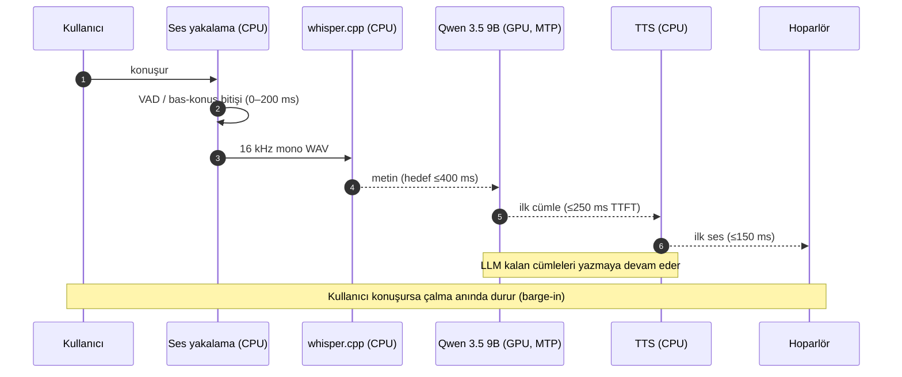

# Mimari

Bu belge, aybars_says'in (eski adı: mamidChats Chatbot) tasarımını, veri akışını ve **gecikme
bütçesini** tanımlar.

## 1. Ana ilke

**GPU'da yalnızca dil modeli çalışır; STT ve TTS CPU'da çalışır.**

Sebep: 8 GB VRAM'de Qwen 3.5 9B (imatrix Q5_K_M, MTP'li hâlde) kartın sınırına oturur. STT
(whisper.cpp) ve TTS'i GPU'ya almak model takasını zorunlu kılar — bu da `<1 sn` hedefini öldürür.
Bu yüzden iş bölümü yapılır ve dil modeli **yerleşik** kalır.

## 2. Veri akışı

```
                 ┌─────────────────────────── CPU ───────────────────────────┐
                 │                                                            │
 Mikrofon ──► VAD/kayıt ──► whisper.cpp ──► metin                            │
                 │                            │                              │
                 │                            ▼                              │
                 │                 ┌──── GPU: Qwen 3.5 9B (MTP) ────┐        │
                 │                 │  yanıt tokenları (akış)         │        │
                 │                 └────────────┬───────────────────┘        │
                 │                              ▼                            │
 Hoparlör ◄── çalma ◄── TTS (Chatterbox/Piper) ◄── ilk cümle ◄──┘             │
                 └────────────────────────────────────────────────────────────┘
```

**Boru hattı (paralel):** LLM ilk cümleyi üretir → hemen TTS'e gider → kullanıcı onu duyarken LLM
kalanı yazar. Toplam gecikme = en yavaş tek zincir.

### 2.1 Bir turun zaman çizelgesi



### 2.2 Bileşen sorumlulukları

| Bileşen | Sorumluluk | Girdi | Çıktı | Hata durumu |
|---|---|---|---|---|
| Ses yakalama | Kaydet, VAD/bitiş kararı | Mikrofon | 16 kHz mono WAV | Cihaz yok → bildir, turu iptal |
| ASR (whisper.cpp) | Konuşmayı yazıya çevir | WAV | Metin | Boş/anlamsız → "anlayamadım" |
| LLM (9B + MTP) | Yanıt üret (akış) | Metin + geçmiş | Token akışı | Sunucu yok → yeniden başlat |
| Boru hattı | Paralelleştir, cümleye böl | Token akışı | Cümleler | Zaman aşımı → kısmi yanıt |
| TTS | Cümleyi sese çevir | Cümle | Ses | Motor hatası → metne düş |
| Çalma | Ses çal, barge-in'de dur | Ses | Hoparlör | Cihaz yok → metne düş |
| Arayüz (WinForms) | Durum, geçmiş, mod | Olaylar | UI | — |

## 3. Gecikme bütçesi (hedef < 1000 ms)

| Aşama | Hedef | Yöntem |
|---|---|---|
| Endpoint | 0–200 ms | Bas-konuş = 0; VAD + ~200 ms eşik |
| STT (whisper.cpp) | ≤ 400 ms | `large-v3-turbo`; gerekirse `medium`/`small` |
| LLM ilk token | ≤ 250 ms | Yerleşik model + **KV prefix cache** |
| TTS ilk ses | ≤ 150 ms | Chatterbox/Piper, ilk cümlede (Trendyol-TTS/`voxcpm` canlı için uygun değil) |
| Çalma tamponu | ~50 ms | Küçük tampon |

> t₀ = son sözcük bitti · t₁ = ilk ses çıktı · Hedef `t₁ − t₀ < 1000 ms`

## 4. STT: whisper.cpp

Ses → yazı, **whisper.cpp** ile yapılır (Qwen3-ASR kullanılmaz).

> **Tarihçe:** İlk planda STT için whisper.cpp (`large-v3-turbo`) seçilmişti; bir ara
> **Qwen3-ASR-1.7B**'ye geçildi; **2026-10-16**'da whisper.cpp'ye geri dönüldü. Gerekçe ve
> alternatifler için bkz. [`kararlar.md`](kararlar.md) → karar #11.

| Alan | Değer |
|---|---|
| Motor | **whisper.cpp** (MIT, C/C++) |
| Model | **large-v3-turbo** (varsayılan) |
| Lisans | MIT (motor ve ağırlıklar) |
| Dil | Çok dilli; **Türkçe (tr) destekli** |
| Yetenek | Çevrimdışı toplu çıkarım; akışlı/parçalı kullanım mümkün |
| Boyut | turbo ~1,6 GB (Q5) · medium ~1,5 GB · small ~0,5 GB |
| Nerede | **CPU** — `whisper.cpp` / `whisper-cli` |
| Yedek | `medium`, `small` (daha hızlı, biraz daha zayıf) |

- Olgun, yaygın; CPU thread ayarıyla iyi ölçeklenir.
- **Hız uyarısı:** `large-v3-turbo` CPU'da tipik cümlede ~0,2–0,4 sn. Uzun cümlede `<1 sn` sınırda;
  VAD ile bölütleme + parça paralelliği telafi eder. Gerekirse `medium`/`small`'a inilir. Faz 2'de ölçülür.
- Silero VAD ile konuşma bölütlenir (boş bölge filtresi).

## 5. LLM: Huihui-Qwen3.5-9B-abliterated i1-Q5_K_M + MTP (daima açık)

| Alan | Değer |
|---|---|
| Model | **Huihui-Qwen3.5-9B-abliterated i1-Q5_K_M** (GGUF, imatrix) |
| Dosya | `Huihui-Qwen3.5-9B-abliterated.i1-Q5_K_M.gguf` (~6,6 GB) |
| HF deposu | `mradermacher/Huihui-Qwen3.5-9B-abliterated-i1-GGUF` |
| Taban | `huihui-ai/Huihui-Qwen3.5-9B-abliterated` |
| MTP | `mtp_inject.py` ile `blk.<N>.nextn.*` |
| Çalıştırma | `llama-server` + `--spec-type draft-mtp` |
| mmproj | İsteğe bağlı; ses-odaklı → **varsayılan yüklenmez** |

- GPU'da **yerleşik**; turlar arasında boşaltılmaz.
- **MTP kayıpsız** (kabul edilen tokenlar hedef modelle doğrulanır); MamidLabs ölçümü ~2x hız.
- **KV prefix cache**: her turda yalnızca yeni tokenlar işlenir.
- **Doğrulandı:** quant GGUF MTP/`nextn` **içermez**; `mtp_inject.py` ile taban `huihui-ai`
  deposundan geri eklenir (15 tensor mevcut). Kabul testleri: [`mtp-dogrulama.md`](mtp-dogrulama.md).

## 6. TTS: takas edilebilir katman

| Motor | Doğallık | Türkçe | CPU'da gerçek zamanlı | Lisans | Rol |
|---|---|---|---|---|---|
| **Chatterbox Multilingual v3** | En yüksek | ⚠️ zayıf | ❌ (GPU ister) | MIT | EN birincil (gerçekçi) |
| **Trendyol-TTS** (`voxcpm`; VoxCPM2 + TR LoRA) | Yüksek | ✅ anlaşılır | ❌ (GPU'da bile RTF ~3) | MIT | **TR çevrimdışı/yüksek kalite** |
| **Piper** | Orta | ✅ | ✅ | GPL-3.0 | Hızlı/yedek |
| XTTS-v2 | Yüksek | ✅ | ❌ | Ticari dışı | Alternatif |
| Kokoro / F5-TTS | Yüksek | ❌ | ✅ / ❌ | Apache / CC-BY-NC | TR yok → elenir |
| Windows SAPI | Düşük | ✅ | ✅ | — | Son çare |

- Varsayılan **Chatterbox v3**; GPU'da ~2–3 GB → LLM Q4 ile ~8 GB (ölçüm şart).
- GPU sıkışırsa **Piper** (CPU) canlı moda düşer.
- Chatterbox çıktıları PerTh filigranı taşır (MIT, duyulmaz) — engel değil.
- **Trendyol-TTS (`voxcpm`):** TR native ve anlaşılır (geri-çevirim WER ~0,08) **ama** ~5,6 GB VRAM +
  RTF ~3 → canlı `<1 sn` hattına **alınmadı**; çevrimdışı/yüksek kalite motoru (karar #16). Ayrıntı:
  [`tts-tr-sonuc.md`](tts-tr-sonuc.md).
- **Projeye dahil değil:** **Fish Audio S2 Pro** yalnızca izole WSL denemesidir (ticari dışı lisans,
  yalnız Linux/WSL, 24 GB) — bkz. [`kararlar.md`](kararlar.md) karar #15.

## 7. Kaynak bütçesi (8 GB VRAM)

| Kaynak | Kullanım |
|---|---|
| GPU (8 GB) | Huihui-Qwen3.5-9B i1-Q5_K_M (~6,6 GB) + MTP + KV cache (kartın sınırında) |
| CPU çekirdekleri | whisper.cpp (dinleme) **veya** TTS (konuşma) — sırayla |

> **Not:** i1-Q5_K_M tek başına ~6,6 GB; **MTP başlığı (~bir transformer bloğu)** + KV cache ile
> 8 GB'a çok yaklaşır. Sıkışırsa **i1-Q4_K_M** (~5,6 GB), `q4_0` KV veya düşük `-c` değerlendirilir.
> Enjeksiyon sonrası VRAM **ölçülmelidir** (bkz. [`mtp-dogrulama.md`](mtp-dogrulama.md)).

### 7.1 Donanım profilleri (A / B)

İki hedef makine için önerilen dağılım. **Değişmez kural:** GPU'da **yalnız LLM**; STT+TTS CPU'da
(model takası yok). Aşağıdaki iki profil bu kural etrafında ölçeklenir.

> Değerler **tahmin/aralık**; LLM dışındaki rakamlar bu makinede henüz ölçülmedi.
> KV önbellek ~72 KB/token → 4k ctx ≈ 0,3 GB · 8k ≈ 0,6 GB · 32k ≈ 2,3 GB.
>
> 🎯 **Bu bir sesli SOHBET botu → kısa bağlam yeterlidir.** Hedef **4k** (kayan pencere), üst sınır
> **8k**. Uzun (32k) bağlama gerek yok → KV ~0,3–0,6 GB'da kalır (`llama-server -c 4096`). Böylece
> LLM ayak izi düşer ve iki profil de rahatlar.

#### Profil A — 8 GB VRAM · 16 GB RAM (hedef/düşük)

| Rol | Motor | Nerede | Kaynak | Not |
|---|---|---|---|---|
| LLM | Qwen3.5-9B **i1-Q5_K_M** + MTP | **GPU** | **~7,0 GB** (@4k) – ~7,3 (@8k) | kısa bağlam; sıkışırsa **i1-Q4_K_M** (~5,6 GB) |
| STT | whisper.cpp **large-v3-turbo** | **CPU** | RAM ~2 GB | gerekirse `medium`/`small` |
| TTS (canlı) | **Piper** | **CPU** | RAM ~0,1 GB | robotik ama hızlı |
| TTS (kalite/offline) | **Chatterbox** (TR fix) | **CPU** | RAM ~2–3 GB | CPU'da yavaş (RTF>1 olabilir) |
| **Toplam** | | | **GPU ~7,0 / 8 GB** · **RAM ~8–12 / 16 GB** | Whisper+TTS GPU'ya **alınamaz** |

#### Profil B — 16 GB VRAM · 32 GB RAM (mevcut makine)

| Rol | Motor | Nerede | Kaynak | Not |
|---|---|---|---|---|
| LLM | Qwen3.5-9B i1-Q5_K_M + MTP | **GPU** | **~7,0 GB** (@4k) | kısa bağlam yeterli → KV küçük |
| STT | whisper.cpp large-v3-turbo | CPU **veya GPU** | CPU RAM ~2 GB · GPU ~2 GB | GPU'da daha hızlı |
| TTS | Chatterbox (TR fix) | CPU **veya GPU** | GPU ~2–3 GB | GPU'da gerçek zamana yakın |
| **Üçü birlikte (hepsi GPU)** | | **GPU** | **~11–12 / 16 GB** | sığar, **~4–5 GB boşluk** |

**Önerilen varyantlar (Profil B):**
- **B-1 (kurala sadık):** LLM GPU; STT+TTS CPU → GPU rahat (~7 GB), CPU yükü yük.
- **B-2 (dengeli):** LLM + Chatterbox **GPU'da** (~9–10 GB), Whisper CPU → iyi gecikme/hız.
- **B-3 (en düşük gecikme):** üçü de **GPU'da** (~11–12 GB) → 16 GB'a **rahat sığar**.

> **VoxCPM2 / Trendyol-TTS (~5,6 GB):** Profil A'da **imkânsız**; Profil B'de LLM ile ~13–15 GB →
> çok sıkışır → her iki profilde de **çevrimdışı** kalır (karar #16).

## 8. Önerilen dosya yapısı

| Yol | İçerik |
|---|---|
| `mamidchats-desktop.ps1` | WinForms arayüzü, olay döngüsü |
| `agent/llm-run.ps1` | `llama-server`, MTP, VRAM kapısı |
| `agent/asr-tools.py` | whisper.cpp çıkarımı |
| `agent/tts-tools.py` | Chatterbox / voxcpm (Trendyol-TTS) / Piper / SAPI |
| `agent/pipeline.ps1` | ASR → LLM → cümle → TTS (**iskelet**, `agent/pipeline.ps1`) |
| `agent/audio-capture.ps1` | winmm kayıt |

## 9. Riskler ve açık sorular

1. **whisper.cpp CPU hızı.** `large-v3-turbo` `<1 sn` için genelde yeterli; uzun cümlede `medium`/`small`
   yedeği veya akış optimizasyonu gerekebilir.
2. **MTP enjeksiyonu.** Quant GGUF MTP'yi içermez; `mtp_inject.py` şart. Enjeksiyon sonrası
   `has_mtp`, `block_count`, sunucu açılışı doğrulanır (bkz. [`mtp-dogrulama.md`](mtp-dogrulama.md)).
   Başarısızsa orijinal `huihui-ai` GGUF'a dönülür.
3. **Endpoint sezgisi.** VAD agresif/yavaş dengesi; bas-konuş sıfırlar.
4. **Barge-in.** Yankı riski → kulaklık/yankı bastırma.
5. **TTS GPU payı.** Chatterbox GPU'ya alınırsa LLM Q4'e inmeli; ölçüm gerek.
6. **VRAM sınırı.** i1-Q5_K_M + MTP + KV 8 GB'ın sınırında; gerçek ölçüm şart.
