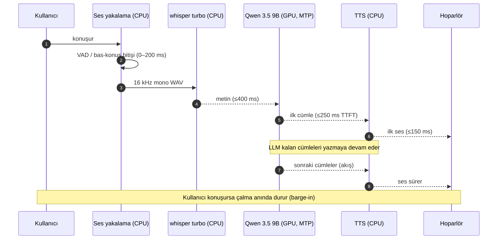

# Mimari

Bu belge, mamidChats Chatbot'un tasarımını, veri akışını ve **gecikme bütçesini** tanımlar.
Kod yok; üzerine inşa edilecek plan.

## 1. Ana ilke

**GPU'da yalnızca dil modeli çalışır; STT ve TTS CPU'da çalışır.**

Sebep: 8 GB VRAM'de Qwen 3.5 9B MTP'li hâlde kartın sınırına oturur. whisper ve TTS'i GPU'ya
almak model takasını (ve saniyeler süren yeniden yüklemeyi) zorunlu kılar — bu da < 1 sn hedefini
öldürür. Bu yüzden iş bölümü yapılır ve dil modeli **yerleşik** kalır.

## 2. Veri akışı

```
                 ┌─────────────────────────── CPU ───────────────────────────┐
                 │                                                            │
 Mikrofon ──► VAD/kayıt ──► whisper.cpp turbo ──► metin                        │
                 │                                   │                        │
                 │                                   ▼                        │
                 │                        ┌──── GPU: Qwen 3.5 9B (MTP) ────┐   │
                 │                        │  yanıt tokenları (akış)         │  │
                 │                        └────────────┬───────────────────┘   │
                 │                                     ▼                        │
 Hoparlör ◄── çalma ◄── TTS (Piper/XTTS/SAPI) ◄── ilk cümle ◄──┘                │
                 │                                                            │
                 └────────────────────────────────────────────────────────────┘
```

**Boru hattı (paralel):** LLM ilk cümleyi üretir → hemen TTS'e gider → kullanıcı onu duyarken LLM
kalanı yazar. Aşamalar üst üste biner; toplam gecikme = en yavaş tek zincir, hepsinin toplamı değil.

### 2.1 Bir turun zaman çizelgesi



### 2.2 Bileşen sorumlulukları

| Bileşen | Sorumluluk | Girdi | Çıktı | Hata durumu |
|---|---|---|---|---|
| Ses yakalama | Mikrofonu kaydet, VAD/bitiş kararı | Mikrofon | 16 kHz mono WAV | Cihaz yok → bildir, turu iptal |
| STT (whisper turbo) | Konuşmayı yazıya çevir | WAV | Metin | Boş/anlamsız → "anlayamadım", yeniden dinle |
| LLM (9B + MTP) | Yanıt üret (akış) | Metin + geçmiş | Token akışı | Sunucu yok → yeniden başlat, durum göster |
| Boru hattı | Aşamaları paralelleştir, cümleye böl | Token akışı | Cümle birimleri | Zaman aşımı → kısmi yanıtı sun |
| TTS | Cümleyi sese çevir | Cümle | Ses | Motor hatası → metne düş (ekranda göster) |
| Çalma | Sesi çal, barge-in'de dur | Ses | Hoparlör | Cihaz yok → metne düş |
| Arayüz (WinForms) | Durum, geçmiş, mod seçimi | Olaylar | UI | — |

## 3. Gecikme bütçesi (hedef < 1000 ms)

| Aşama | Hedef | Yöntem |
|---|---|---|
| Endpoint (konuşma bitti mi?) | 0–200 ms | Bas-konuş = 0; VAD'de Silero + ~200 ms eşik |
| STT kısmi/final metin | ≤ 400 ms | **large-v3-turbo** CPU'da (akış/kısa pencere) |
| LLM ilk token | ≤ 250 ms | Model **yerleşik** + **KV prefix cache** |
| TTS ilk ses | ≤ 150 ms | Piper, **ilk cümlede** tetikle |
| Çalma tamponu | ~50 ms | Küçük tampon + öncelikli ses thread'i |
| **Toplam (paralel)** | **≈ 800 ms** | — |

> t₀ = kullanıcı son sözcüğü bitirdi · t₁ = ilk ses çıktı · Hedef `t₁ − t₀ < 1000 ms`

## 4. STT: neden turbo

- Sohbet, **doğruluk-kritik** değil; hız kritik. `large-v3` CPU'da yavaş ve < 1 sn hedefini tek
  başına yer.
- `large-v3-turbo` (distil edilmiş decoder) CPU'da ~0,2–0,4 sn → hedefe rahat sığar ve GPU'yu
  serbest bırakır.
- Silero VAD ile halüsinasyon sıfırlanır (MamidLabs'ta ölçülmüş: VAD halüsinasyonu kaldırır).
- İleride gerekirse iki geçişli (turbo kısmi → large-v3 rafine) yükseltme kapısı açık bırakılır;
  varsayılan **turbo**.

## 5. LLM: Huihui-Qwen3.5 9B (LITE ile aynı) + MTP (daima açık)

MamidLabs LITE profilinde çalışan modelin **aynısı** kullanılır:

| Alan | Değer |
|---|---|
| Model | **Huihui-Qwen3.5 9B Q5_K_M** (GGUF) |
| MTP | `mtp_inject.py` ile `blk.<N>.nextn.*` geri eklenir (kaynak: `huihui-ai/Huihui-Qwen3.5-9B-abliterated`) |
| Çalıştırma | `llama-server` + `--spec-type draft-mtp` |
| Bağlam | varsayılan 32768 |
| mmproj | Q8_0 isteğe bağlı; bu proje ses-odaklı → **varsayılan yüklenmez** (VRAM tasarrufu) |

- **Yeniden indirme yok:** dosyalar MamidLabs kökünde mevcut; paylaşılabilir.
- Model GPU'da **yerleşik** çalışır; turlar arasında boşaltılmaz.
- **MTP (Multi-Token Prediction)** `--spec-type draft-mtp` ile **daima açık** (kesin kural):
  - Ayrı draft model gerekmez (GGUF'un gömülü `nextn` başlığını kullanır).
  - Çıktı **kayıpsız** (kabul edilen tokenlar hedef modelle doğrulanır).
  - MamidLabs ölçümü: kabul ~0,93, ~2x hız (36 → ~75 tok/s).
  - Bayrak yalnızca GGUF gerçekten MTP katmanı taşıyorsa eklenir (`Test-GgufHasMtp`).
- Bu projede ComfyUI/OCR olmadığı için GPU tamamen modele ayrılır → LITE'ın kutudaki küçük
  aşımı (tolerans 1024 MiB) burada **beklenmez**; daha rahat sığar.
- **KV prefix cache**: her turda yalnızca yeni tokenlar işlenir; geçmiş baştan işlenmez.

## 6. TTS: takas edilebilir katman

| Motor | Doğallık | Türkçe | CPU'da gerçek zamanlı | Lisans | Rol |
|---|---|---|---|---|---|
| **Piper** | Orta | ✅ | ✅ (RTF ~0,35) | GPL-3.0 | **Varsayılan (canlı)** |
| **XTTS-v2** | En yüksek (+klonlama) | ✅ (17 dil) | ❌ | Ticari dışı (CPML) | Opsiyonel "yüksek kalite" |
| Kokoro-82M | Yüksek | ❌ | ✅ | Apache-2.0 | TR yok → elenir |
| F5-TTS | Çok yüksek | ❌ (EN/ZH) | ❌ | CC-BY-NC | TR yok → elenir |
| Windows SAPI | Düşük | ✅ | ✅ | — | Yedek / sıfır kurulum |

- Motor **takas edilebilir** tasarlanır; varsayılan Piper (düşük gecikme), "yüksek kalite" modu XTTS.
- Bu, MamidLabs'taki `audioQuality normal/high` deseninin TTS ikizidir.
- ⚠️ **Lisans:** XTTS-v2 ticari kullanıma kapalı. Proje **kişisel/kapalı** olduğu için sorun değil;
  ileride dağıtım gündeme gelirse Chatterbox (MIT) veya Piper'a geçilir.

## 7. Kaynak bütçesi (8 GB VRAM)

| Kaynak | Kullanım |
|---|---|
| GPU (8 GB) | Qwen 3.5 9B + MTP + KV cache (kartın sınırında) |
| CPU çekirdekleri | whisper turbo (dinleme) **veya** TTS (konuşma) — sırayla, çakışmaz |

- STT (dinlerken) ve TTS (konuşurken) aynı anda çalışmaz → CPU çekişmesi düşük.
- llama.cpp yalnızca GPU'da; CPU payı önemsiz.

## 8. Önerilen bileşen/dosya yapısı (MamidLabs deseni)

| Yol | İçerik |
|---|---|
| `mamidchats-desktop.ps1` | Ana uygulama: WinForms arayüzü, sohbet durumu, olay döngüsü |
| `agent/llm-run.ps1` | `llama-server` başlat/durdur, MTP, VRAM kapısı (MamidLabs `manage-qwen.ps1` uyarlaması) |
| `agent/stt-tools.py` | 16 kHz mono dönüştürme + `whisper-cli` turbo + Silero VAD |
| `agent/tts-tools.py` | Takas edilebilir TTS: Piper / XTTS / SAPI |
| `agent/pipeline.ps1` | Boru hattı orkestrasyonu: STT → LLM (akış) → cümle bölme → TTS |
| `agent/audio-capture.ps1` | winmm `mciSendString` ile bağımlılıksız kayıt (MamidLabs deseni) |
| `scripts/` | kurulum, model indirme, tanı |
| `docs/` | bu belgeler |
| `tests/` | pytest + gerçek pwsh |

## 9. Riskler ve açık sorular

1. **Endpoint sezgisi.** VAD çok agresifse cümleyi keser, çok yavaşsa gecikme artar. Bas-konuş bunu
   sıfırlar; sürekli modda eşik ayarı gerekir.
2. **Akışlı STT.** whisper.cpp düzgün akış sunmaz; kısa pencereler + kısmi metin yaklaşımı test
   edilmeli. Varsayılan: konuşma bitince turbo ile hızlı final (hedefe yeter).
3. **Barge-in.** Kullanıcı konuşurken çalmayı anında kesme; yankı (echo) riski → kulaklık önerisi
   veya yankı bastırma.
4. **TTS ilk ses gecikmesi.** Piper'da ölçülmeli; XTTS GPU'ya alınırsa LLM ile VRAM çakışması.
5. **9B MTP VRAM payı.** Q5'te kartın sınırında (MamidLabs ölçümü); TTS'i GPU'ya almak için Q4'e
   inmek gerekebilir — ayrı ölçüm işi.
